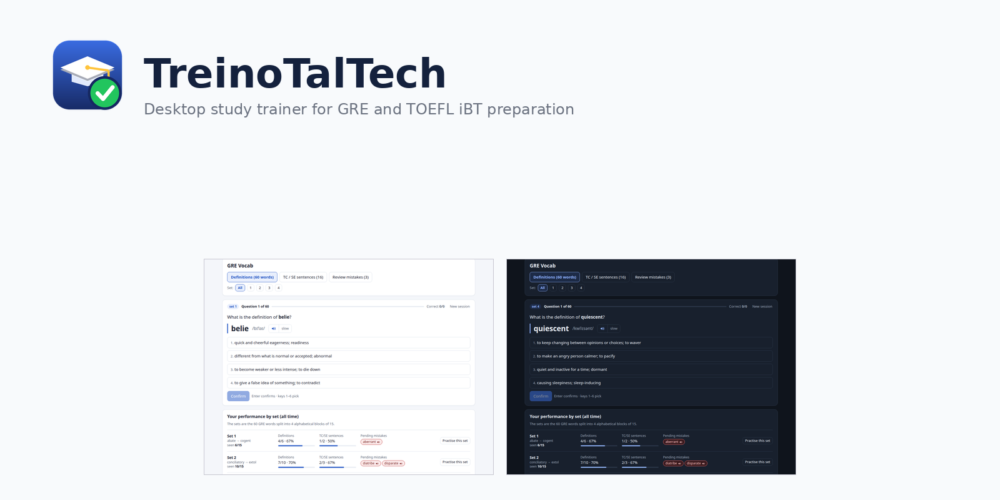
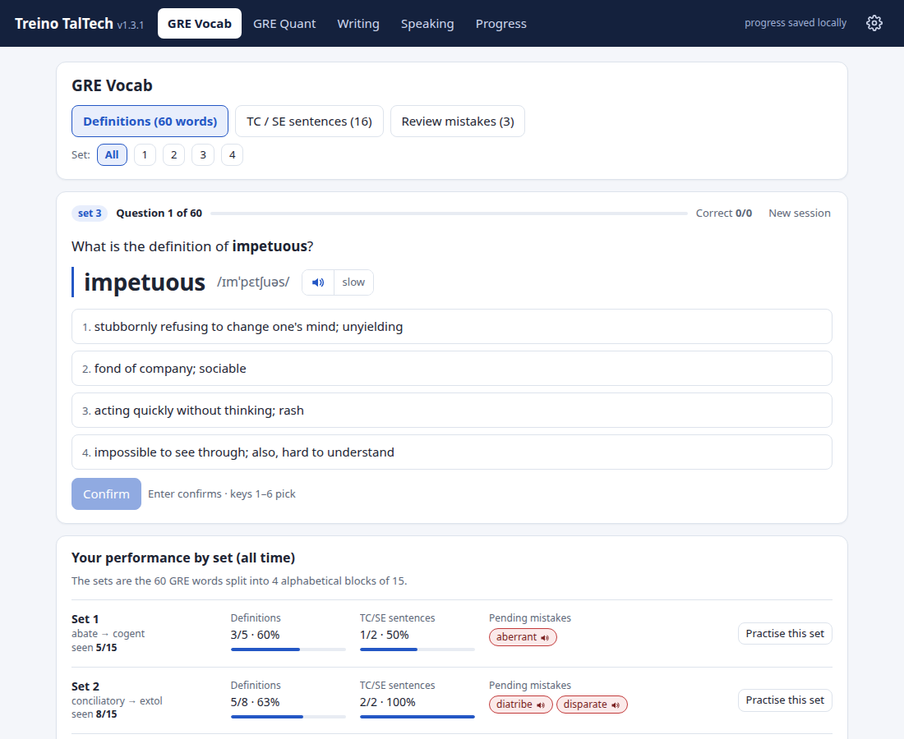
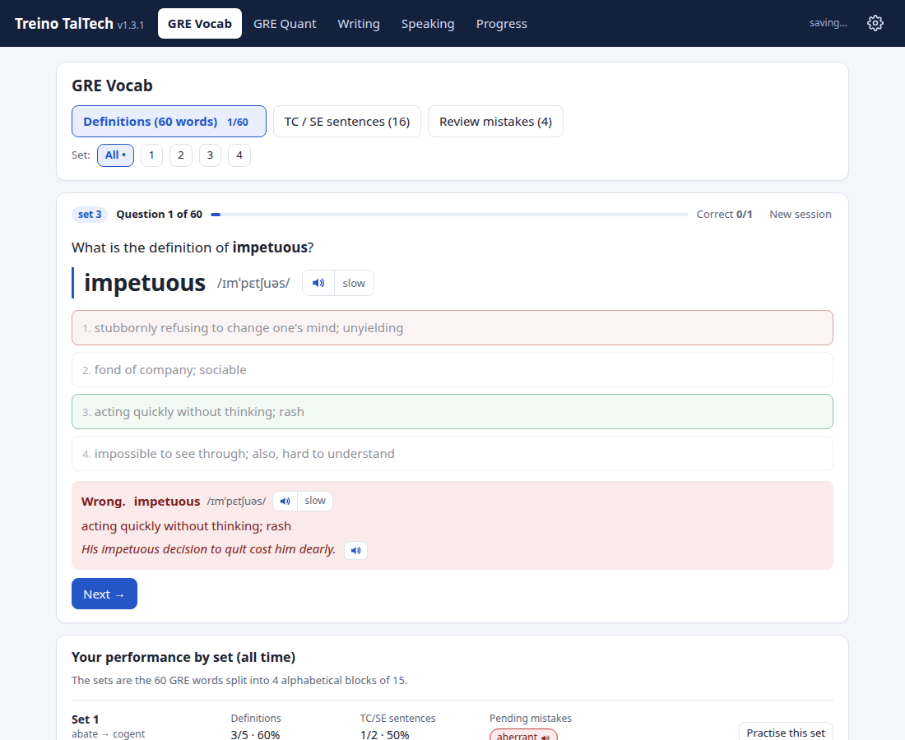
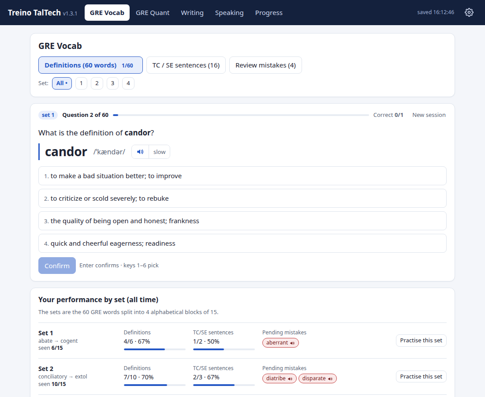
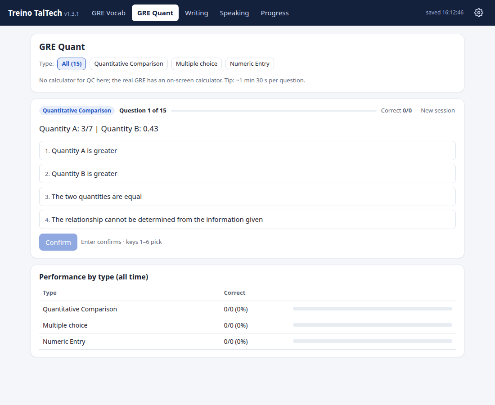
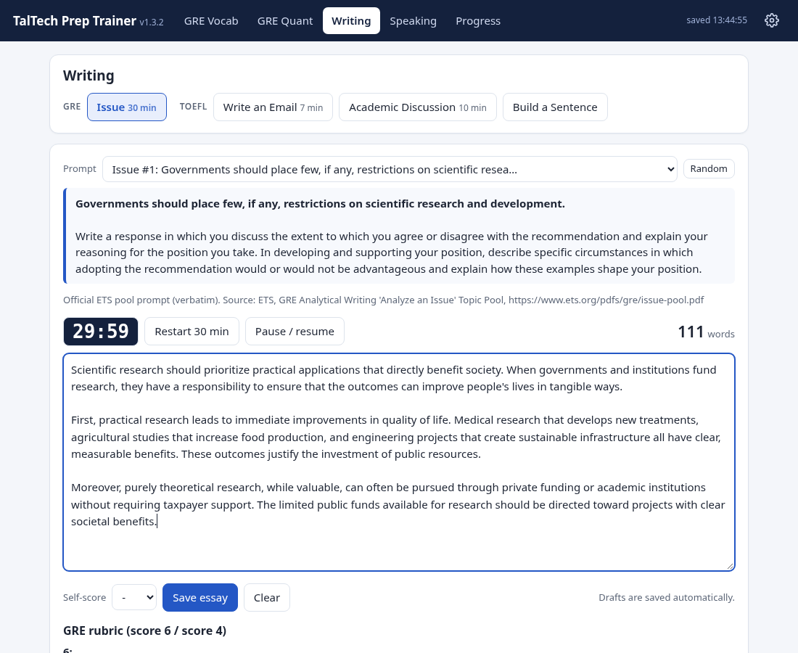
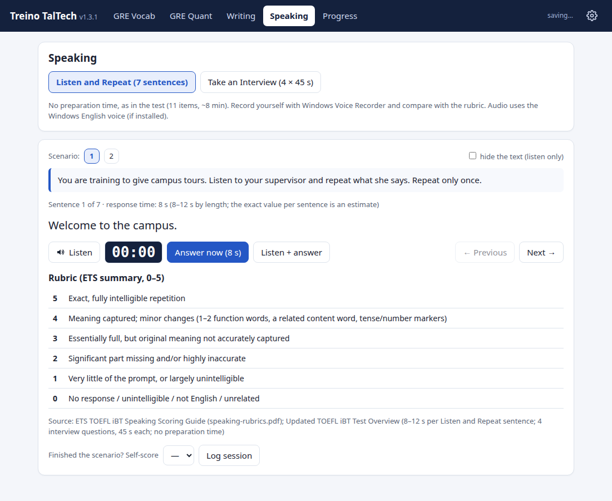
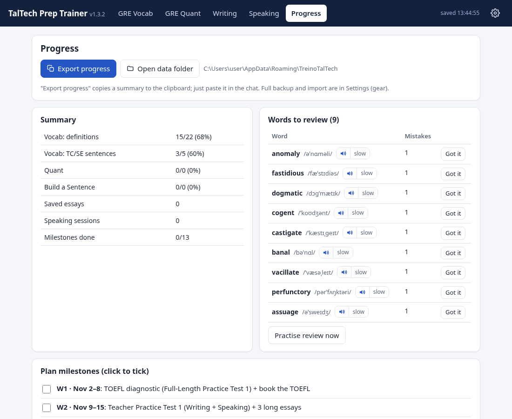
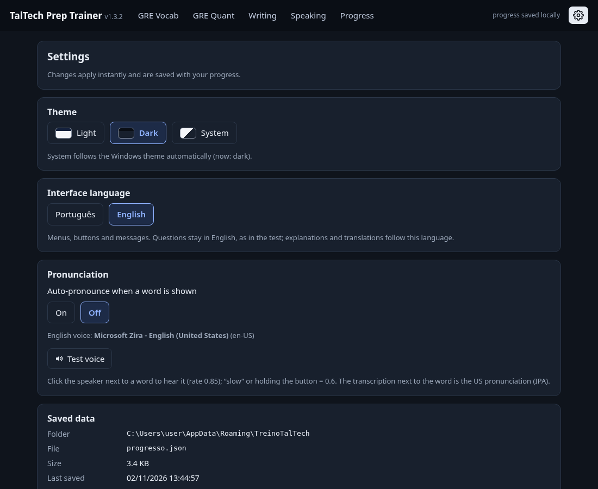

# TalTech Prep Trainer

<p align="center">
  
</p>

<p align="center">
  <strong>Desktop study trainer for GRE and TOEFL iBT (Home Edition) preparation</strong>
</p>

<p align="center">
  
  
  
</p>

<p align="center">
  
</p>

## About

TalTech Prep Trainer is a Windows desktop application I built to prepare for the GRE and TOEFL iBT exams as part of my application to TalTech's MSc program in Computer Science and AI. The app provides targeted practice for vocabulary, quantitative reasoning, essay writing, and speaking exercises, with progress tracking and performance analytics. When the interface is set to Portuguese, the app shows its original name, Treino TalTech. The executable (`TreinoTalTech.exe`) and the data folder keep that name in both languages.

Built entirely in Go using WebView2, the app runs as a native Windows application with a single-page HTML/CSS/JS interface embedded directly into the executable. All progress is saved locally with automatic schema migrations and backup support.

## Features

### GRE Preparation
- **Vocabulary (60 words in 4 sets)**: Definition quizzes, text completion (TC) and sentence equivalence (SE) practice
- **Review mistakes**: Track and practice words you got wrong
- **Pronunciation support**: IPA transcription and Web Speech API audio (slow mode available)
- **Per-set performance**: See your accuracy and progress for each word set
- **Quantitative Reasoning**: Quantitative comparison (QC), multiple choice (MC), and numeric entry (NE) questions
- **Issue Essays**: Practice with official ETS Issue pool prompts, timed sessions (30 minutes)

### TOEFL Preparation
- **Writing tasks**: Email responses (7 minutes), academic discussion (10 minutes), sentence building exercises
- **Speaking practice**: Listen and repeat, interview questions
- **Scoring rubrics**: Self-evaluation with ETS-based rubric summaries

### General Features
- **Progress tracking**: Detailed history of all practice sessions
- **Performance analytics**: Review your performance over time
- **Session persistence**: Sessions persist across tabs and app restarts
- **Theme support**: Light, dark, or system theme
- **Bilingual UI**: Portuguese and English interface options; the app name, window title and About panel follow the selected language
- **Data management**: Export, import, and reset your progress
- **Automatic backups**: Schema migrations create timestamped backups

## Screenshots

<details open>
<summary><strong>Vocabulary Practice</strong></summary>

<p align="center">
  
  <br><em>Vocabulary question with IPA pronunciation and audio support</em>
</p>

<p align="center">
  
  <br><em>Immediate feedback with correct answer highlighted</em>
</p>

<p align="center">
  
  <br><em>Performance tracking by word set with expandable details</em>
</p>

</details>

<details>
<summary><strong>GRE Quantitative Reasoning</strong></summary>

<p align="center">
  
  <br><em>Quantitative comparison questions with column comparison</em>
</p>

</details>

<details>
<summary><strong>Writing Practice</strong></summary>

<p align="center">
  
  <br><em>Issue essay editor with 30-minute timer and prompt display</em>
</p>

</details>

<details>
<summary><strong>Speaking Practice</strong></summary>

<p align="center">
  
  <br><em>Speaking exercises with rubrics and self-evaluation</em>
</p>

</details>

<details>
<summary><strong>Progress & Settings</strong></summary>

<p align="center">
  
  <br><em>Detailed progress history and performance analytics</em>
</p>

<p align="center">
  
  <br><em>Settings panel with theme and language options, data management</em>
</p>

</details>

## Download & Installation

1. **Download** the latest release from the [Releases](https://github.com/RenatoSouzaAN/taltech-prep-trainer/releases) page
2. **Extract** the ZIP file to a folder of your choice
3. **Run** `TreinoTalTech.exe`

**Note**: Windows SmartScreen may show a warning because the executable is not digitally signed. Click "More info" then "Run anyway" to proceed.

**Requirements**: Windows 10/11 with WebView2 runtime (pre-installed on Windows 11 and recent Windows 10 updates)

### Progress Storage

Your progress is automatically saved to:
```
%APPDATA%\TreinoTalTech\progresso.json
```

The app handles schema migrations automatically and creates `.bak` backup files when updating your progress format. Your data is preserved across updates.

## Building from Source

**Prerequisites**: Go 1.27.3 or later

**Cross-compile for Windows from Linux/macOS**:
```bash
cd src
CGO_ENABLED=0 GOOS=windows GOARCH=amd64 go build -trimpath -ldflags="-H windowsgui -s -w" -o ../TreinoTalTech.exe
```

Or use the provided Makefile:
```bash
make build
```

The `src/rsrc_windows_amd64.syso` file contains the compiled Windows resources (icon, manifest and version info) and is included in the repository. To regenerate it after editing `src/winres/winres.json`, install [go-winres](https://github.com/tc-hib/go-winres) (`go install github.com/tc-hib/go-winres@latest`) and run `make winres`.

## Running Tests

**Go tests** (storage and migrations):
```bash
cd src
go test -v
```

**UI tests** (requires Node.js, puppeteer-core, and Chrome):
```bash
cd src
node ui_test.js
```

## Project Structure

```
.
├── src/
│   ├── main.go                   # App entry point, WebView2 setup
│   ├── storage.go                # Progress storage and schema migrations
│   ├── storage_test.go           # Unit tests for storage
│   ├── dialogs_windows.go        # Native Windows file dialogs
│   ├── index.html                # Embedded single-page UI
│   ├── data.json                 # Vocabulary, questions, prompts
│   ├── ui_test.js                # Headless UI tests (Puppeteer)
│   ├── rsrc_windows_amd64.syso   # Compiled Windows resources
│   ├── go.mod / go.sum           # Go dependencies
│   └── winres/                   # Windows resource config and icon
├── tools/
│   ├── audit_shots.js            # Screenshot generation for audits
│   ├── sets_shots.js             # Screenshot generation for sets
│   └── name_shots.js             # Top bar screenshots in English and Portuguese
├── icon/                         # App icon assets
├── build_data.py                 # Script to generate data.json
├── Makefile                      # Build automation
├── LICENSE                       # MIT License
└── README.md                     # This file
```

## Technical Notes

- **Pure Go**: Built with [go-webview2](https://github.com/jchv/go-webview2), no cgo required
- **Cross-compilation**: Developed on Linux, compiled for Windows using `GOOS=windows`
- **Embedded UI**: HTML/CSS/JS packed into the Go binary at compile time
- **Local storage**: Progress saved to `%APPDATA%\TreinoTalTech\progresso.json`
- **Schema migrations**: Automatic backward-compatible updates with `.bak` backups
- **DPI-aware**: Window size adapts to Windows display scaling
- **Web Speech API**: Pronunciation support using browser speech synthesis
- **Single executable**: No external dependencies beyond WebView2 runtime

## Content & Attribution

The practice content in this app was created specifically for GRE and TOEFL preparation:

- **GRE Vocabulary**: The 60-word vocabulary list, definitions, and example sentences are original practice items created for this app
- **Text Completion & Sentence Equivalence**: Original practice sentences designed to reinforce vocabulary learning
- **GRE Quantitative**: Original practice questions covering quantitative comparison, multiple choice, and numeric entry formats
- **GRE Issue Essays**: The essay prompts are quoted from the official [ETS GRE Issue Pool](https://www.ets.org/pdfs/gre/issue-pool.pdf)
- **TOEFL Writing & Speaking**: Original practice tasks and prompts
- **Scoring Rubrics**: Rubric summaries based on official ETS scoring guides

**Disclaimer**: This application is not affiliated with, endorsed by, or sponsored by Educational Testing Service (ETS) or Tallinn University of Technology (TalTech). GRE and TOEFL are registered trademarks of ETS.

## Author

**Renato Souza**  
Computer Engineer & Full-Stack Developer

- GitHub: [@RenatoSouzaAN](https://github.com/RenatoSouzaAN)
- Website: [renatosouza.dev](https://renatosouza.dev)

Built as part of my application to TalTech's MSc in Computer Science and AI.

## License

MIT License. See [LICENSE](LICENSE) for details.

Copyright (c) 2026 Renato Souza
