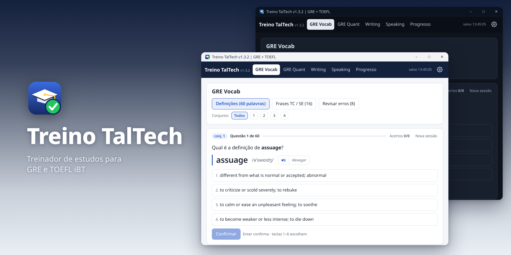
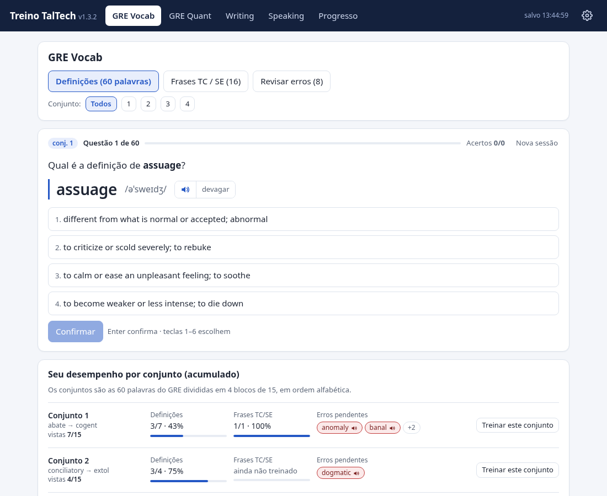
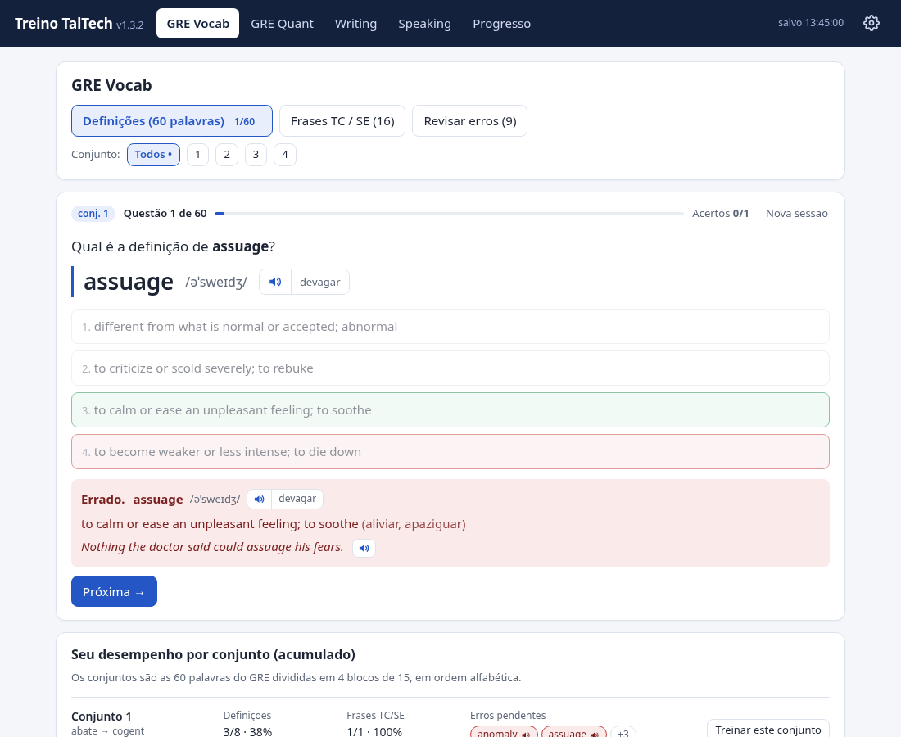
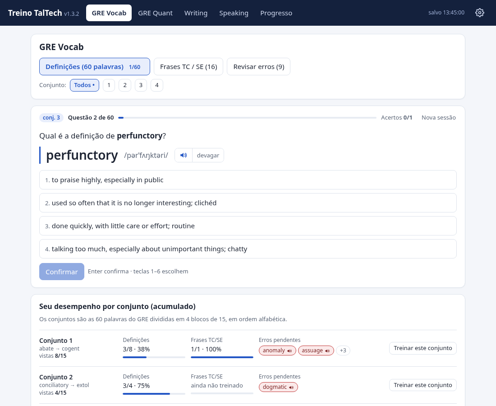
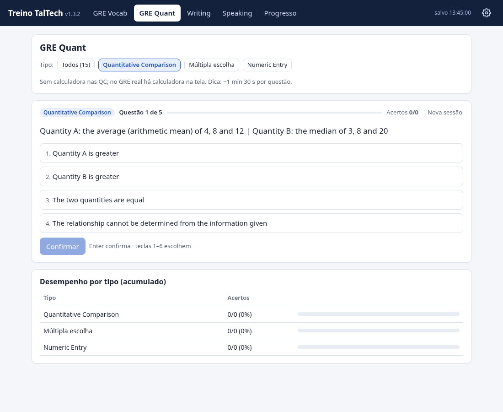
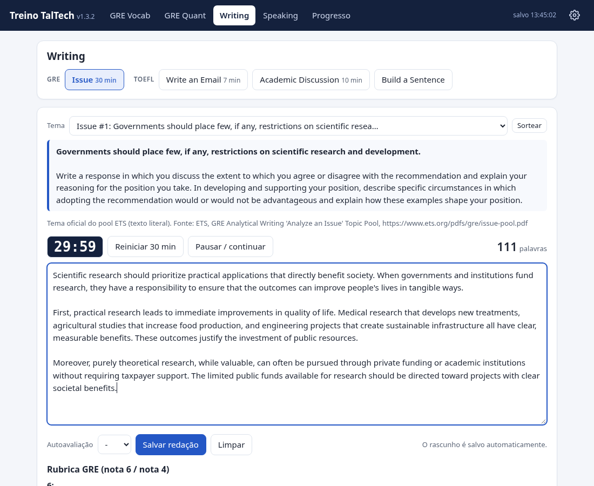
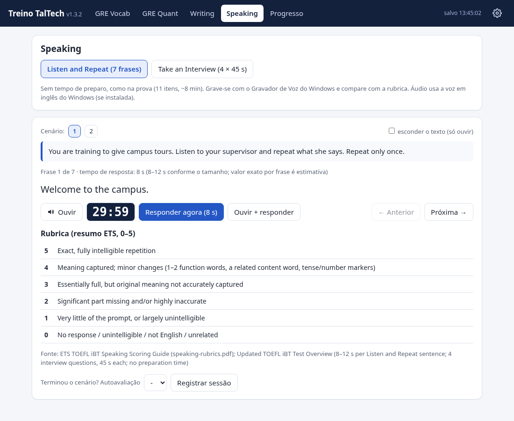
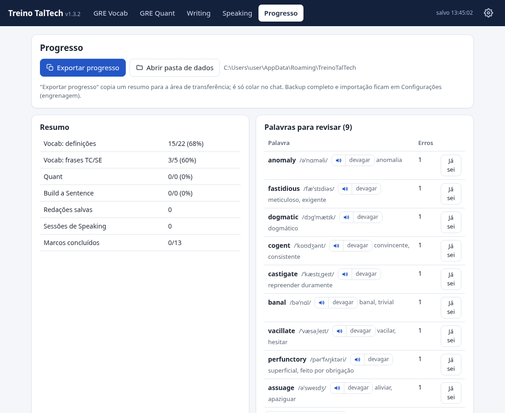
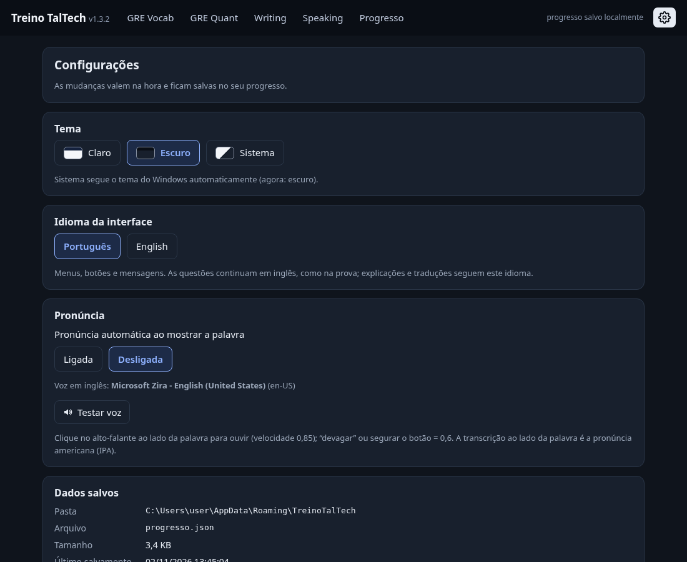

# Treino TalTech

<p align="center"><a href="README.md">English</a> | Português</p>

<p align="center">
  
</p>

<p align="center">
  <strong>Treinador de estudos para desktop, feito para a preparação para o GRE e o TOEFL iBT (Home Edition)</strong>
</p>

<p align="center">
  
  
  
</p>

<p align="center">
  
</p>

## Sobre

O Treino TalTech é um aplicativo para Windows que eu criei para me preparar para o GRE e o TOEFL iBT, como parte da minha candidatura ao mestrado (MSc) em Computer Science and AI da TalTech. Ele oferece prática direcionada de vocabulário, raciocínio quantitativo, redação e fala, com acompanhamento do progresso e estatísticas de desempenho. Com a interface em inglês, o app aparece como TalTech Prep Trainer. O executável (`TreinoTalTech.exe`) e a pasta de dados mantêm o mesmo nome nos dois idiomas.

O app é feito inteiramente em Go com WebView2 e roda como um aplicativo nativo do Windows, com uma interface de página única em HTML/CSS/JS embutida no próprio executável. Todo o progresso fica salvo no seu computador, com migrações automáticas de formato e suporte a backup.

## Recursos

### Preparação para o GRE
- **Vocabulário (60 palavras em 4 conjuntos)**: quiz de definições e prática de Text Completion (TC) e Sentence Equivalence (SE)
- **Revisar erros**: as palavras que você errou ficam guardadas para você praticar de novo
- **Pronúncia**: transcrição IPA e áudio pela Web Speech API (com modo devagar)
- **Desempenho por conjunto**: veja seu aproveitamento e o quanto já avançou em cada conjunto de palavras
- **Raciocínio quantitativo**: questões de Quantitative Comparison (QC), múltipla escolha (MC) e Numeric Entry (NE)
- **Redação Issue**: prática com os temas oficiais do pool Issue da ETS, com cronômetro (30 minutos)

### Preparação para o TOEFL
- **Writing**: Write an Email (7 minutos), Academic Discussion (10 minutos) e Build a Sentence
- **Speaking**: Listen and Repeat e Take an Interview
- **Rubricas**: autoavaliação com resumos das rubricas da ETS

### Recursos gerais
- **Acompanhamento do progresso**: histórico detalhado de todas as sessões de estudo
- **Estatísticas de desempenho**: acompanhe sua evolução ao longo do tempo
- **Sessões preservadas**: a sessão em andamento continua de onde parou, mesmo trocando de aba ou fechando o app
- **Temas**: claro, escuro ou seguindo o sistema
- **Interface bilíngue**: português e inglês; o nome do app, o título da janela e o painel Sobre acompanham o idioma escolhido
- **Gerenciamento de dados**: exporte, importe e zere seu progresso
- **Backups automáticos**: as migrações de formato criam backups com data e hora

## Capturas de tela

<details open>
<summary><strong>Prática de vocabulário</strong></summary>

<p align="center">
  
  <br><em>Questão de vocabulário com pronúncia IPA e áudio</em>
</p>

<p align="center">
  
  <br><em>Correção na hora, com a resposta certa destacada</em>
</p>

<p align="center">
  
  <br><em>Desempenho por conjunto de palavras, com detalhes</em>
</p>

</details>

<details>
<summary><strong>GRE Quantitative Reasoning</strong></summary>

<p align="center">
  
  <br><em>Questões de Quantitative Comparison, comparando as duas colunas</em>
</p>

</details>

<details>
<summary><strong>Prática de Writing</strong></summary>

<p align="center">
  
  <br><em>Editor da redação Issue com cronômetro de 30 minutos e o tema na tela</em>
</p>

</details>

<details>
<summary><strong>Prática de Speaking</strong></summary>

<p align="center">
  
  <br><em>Exercícios de fala com rubricas e autoavaliação</em>
</p>

</details>

<details>
<summary><strong>Progresso e Configurações</strong></summary>

<p align="center">
  
  <br><em>Histórico de progresso e estatísticas de desempenho</em>
</p>

<p align="center">
  
  <br><em>Configurações de tema, idioma e gerenciamento de dados</em>
</p>

</details>

## Download e instalação

1. **Baixe** a versão mais recente na página de [Releases](https://github.com/RenatoSouzaAN/taltech-prep-trainer/releases)
2. **Extraia** o arquivo ZIP em uma pasta de sua escolha
3. **Abra** o `TreinoTalTech.exe`

**Observação**: o Windows SmartScreen pode mostrar um aviso porque o executável não tem assinatura digital. Clique em "Mais informações" e depois em "Executar assim mesmo".

**Requisitos**: Windows 10/11 com o runtime do WebView2 (já vem instalado no Windows 11 e nas atualizações recentes do Windows 10)

### Onde o progresso fica salvo

Seu progresso é salvo automaticamente em:
```
%APPDATA%\TreinoTalTech\progresso.json
```

O app cuida das migrações de formato sozinho e cria arquivos de backup `.bak` sempre que o formato do progresso muda. Seus dados são preservados entre as atualizações.

## Compilando a partir do código-fonte

**Pré-requisito**: Go 1.27.3 ou mais recente

**Compilação cruzada para Windows a partir do Linux/macOS**:
```bash
cd src
CGO_ENABLED=0 GOOS=windows GOARCH=amd64 go build -trimpath -ldflags="-H windowsgui -s -w" -o ../TreinoTalTech.exe
```

Ou use o Makefile:
```bash
make build
```

O arquivo `src/rsrc_windows_amd64.syso` contém os recursos do Windows já compilados (ícone, manifesto e informações de versão) e faz parte do repositório. Para gerá-lo de novo depois de editar `src/winres/winres.json`, instale o [go-winres](https://github.com/tc-hib/go-winres) (`go install github.com/tc-hib/go-winres@latest`) e rode `make winres`.

## Rodando os testes

**Testes em Go** (armazenamento e migrações):
```bash
cd src
go test -v
```

**Testes de interface** (precisam de Node.js, puppeteer-core e Chrome):
```bash
cd src
node ui_test.js
```

## Estrutura do projeto

```
.
├── src/
│   ├── main.go                   # Ponto de entrada do app, configuração do WebView2
│   ├── storage.go                # Armazenamento do progresso e migrações de formato
│   ├── storage_test.go           # Testes unitários do armazenamento
│   ├── dialogs_windows.go        # Diálogos de arquivo nativos do Windows
│   ├── index.html                # Interface de página única embutida
│   ├── data.json                 # Vocabulário, questões e temas
│   ├── ui_test.js                # Testes de interface headless (Puppeteer)
│   ├── rsrc_windows_amd64.syso   # Recursos do Windows compilados
│   ├── go.mod / go.sum           # Dependências do Go
│   └── winres/                   # Configuração de recursos do Windows e ícone
├── tools/
│   ├── audit_shots.js            # Capturas de tela para auditoria visual
│   ├── sets_shots.js             # Capturas de tela dos conjuntos
│   ├── name_shots.js             # Capturas da barra superior em inglês e português
│   ├── readme_shots.js           # Capturas do README (inglês e português)
│   └── hero.js                   # Monta a imagem de destaque do README
├── docs/images/                  # Imagens do README (versões em português em docs/images/pt/)
├── icon/                         # Arquivos do ícone do app
├── build_data.py                 # Script que gera o data.json
├── Makefile                      # Automação do build
├── LICENSE                       # Licença MIT
├── README.md                     # Versão em inglês
└── README.pt-BR.md               # Este arquivo
```

## Notas técnicas

- **Go puro**: feito com [go-webview2](https://github.com/jchv/go-webview2), sem cgo
- **Compilação cruzada**: desenvolvido no Linux e compilado para Windows com `GOOS=windows`
- **Interface embutida**: HTML/CSS/JS vão dentro do binário Go na compilação
- **Armazenamento local**: o progresso fica em `%APPDATA%\TreinoTalTech\progresso.json`
- **Migrações de formato**: atualizações automáticas e compatíveis, com backups `.bak`
- **Ciente de DPI**: o tamanho da janela se adapta à escala de exibição do Windows
- **Web Speech API**: pronúncia pela síntese de voz do navegador
- **Executável único**: nenhuma dependência além do runtime do WebView2

## Conteúdo e créditos

O conteúdo de prática do app foi criado especificamente para a preparação para o GRE e o TOEFL:

- **Vocabulário do GRE**: a lista de 60 palavras, as definições e as frases de exemplo são itens originais, criados para este app
- **Text Completion e Sentence Equivalence**: frases de prática originais, pensadas para fixar o vocabulário
- **GRE Quantitative**: questões originais nos formatos Quantitative Comparison, múltipla escolha e Numeric Entry
- **Redações Issue do GRE**: os temas são citados do [pool oficial de Issue da ETS](https://www.ets.org/pdfs/gre/issue-pool.pdf)
- **Writing e Speaking do TOEFL**: tarefas e enunciados originais
- **Rubricas**: resumos baseados nos guias oficiais de pontuação da ETS

**Aviso**: este aplicativo não tem vínculo com a Educational Testing Service (ETS) nem com a Tallinn University of Technology (TalTech), e não é endossado nem patrocinado por elas. GRE e TOEFL são marcas registradas da ETS.

## Autor

**Renato Souza**  
Engenheiro de Computação e Desenvolvedor Full-Stack

- GitHub: [@RenatoSouzaAN](https://github.com/RenatoSouzaAN)
- Site: [renatosouza.dev](https://renatosouza.dev)

Criado como parte da minha candidatura ao MSc em Computer Science and AI da TalTech.

## Licença

Licença MIT. Veja [LICENSE](LICENSE) para mais detalhes.

Copyright (c) 2026 Renato Souza
